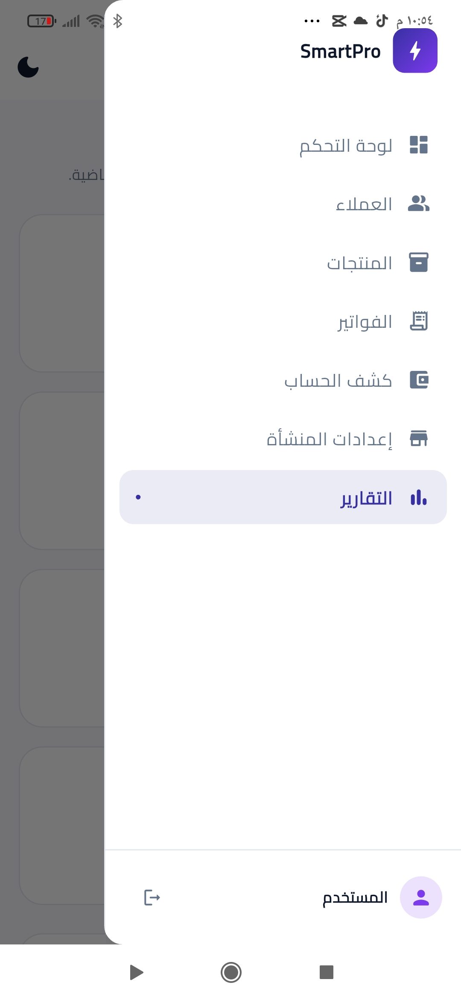
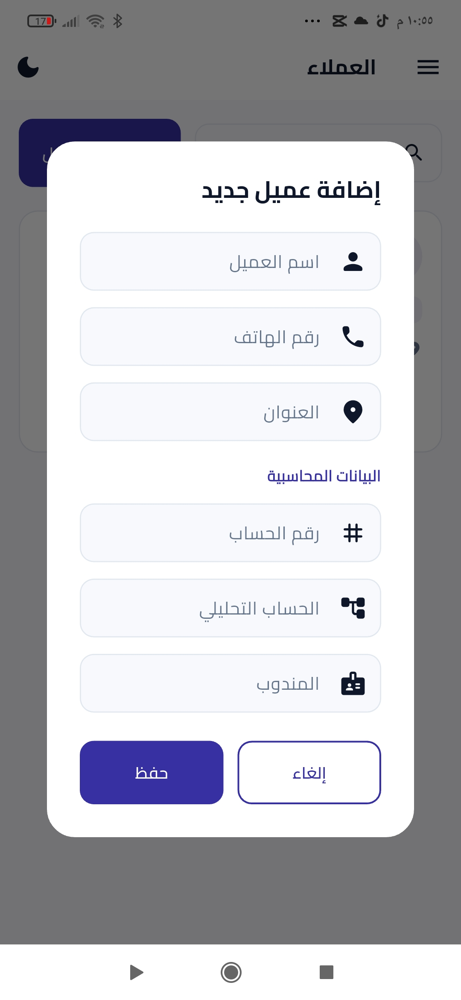
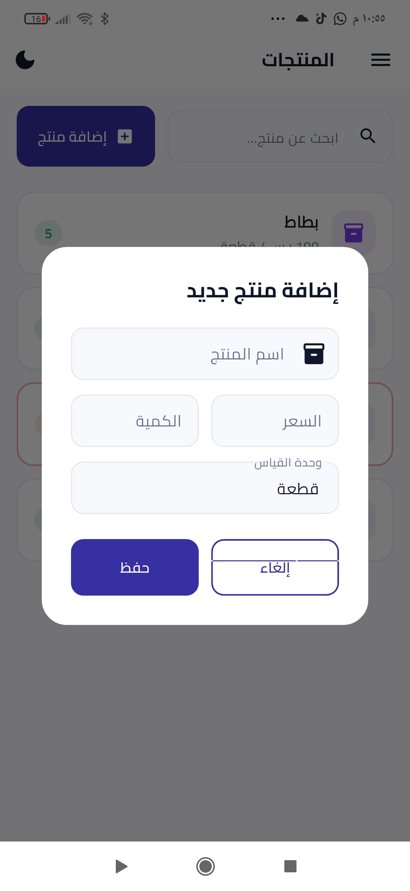
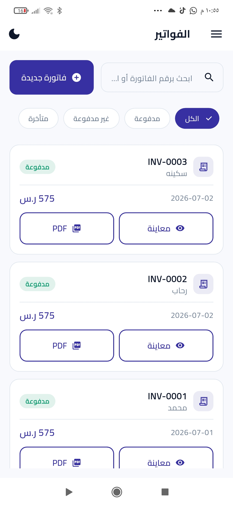
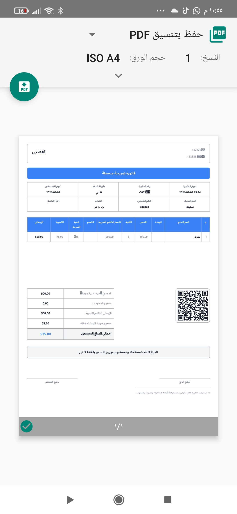
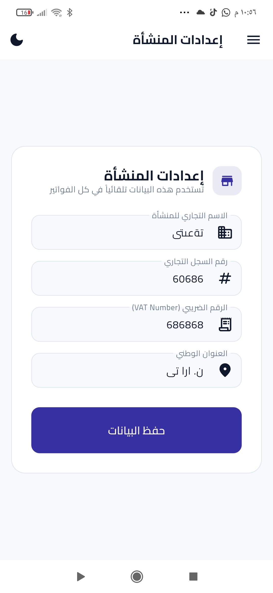
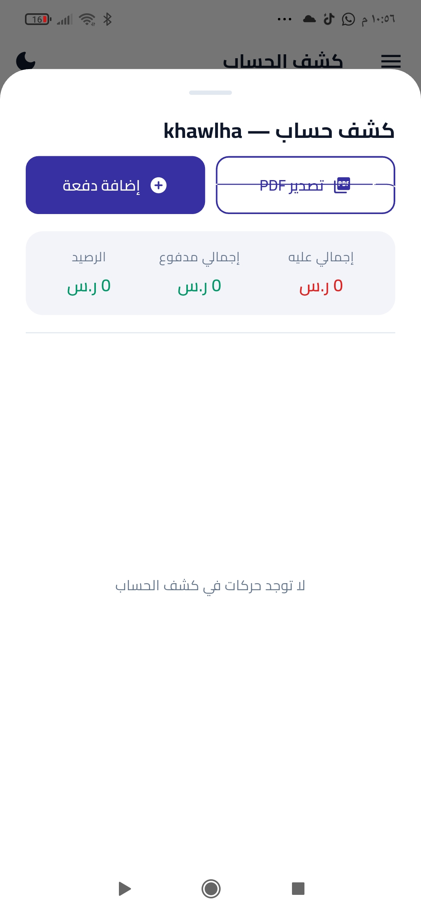
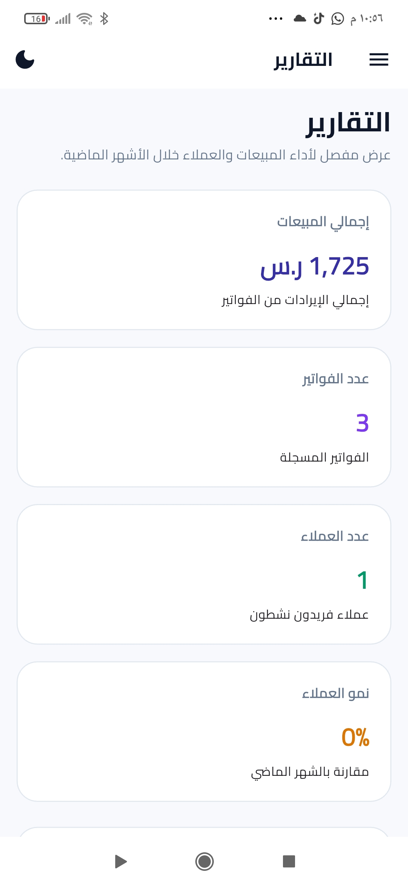
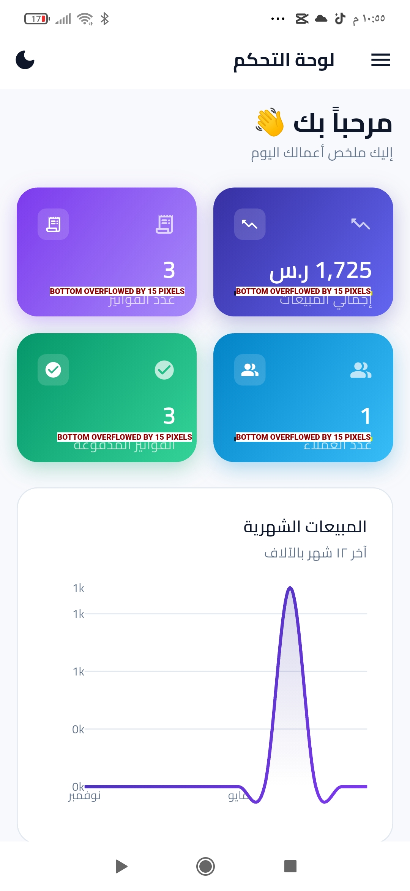
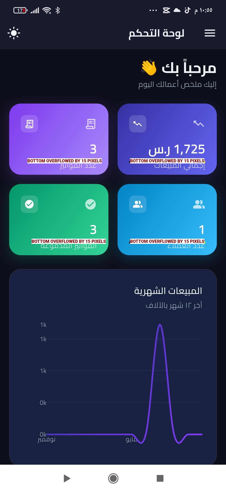

# ⚡ SmartPro - Mobile Invoicing & Business Management System

A modern, professional Flutter application designed for Android, built to streamline business operations, electronic invoicing, customer tracking, and financial reporting with full compliance standards.

---

## 📱 App UI Previews & Screenshots

<div align="center">

| 📊 لوحة التحكم والتقارير | 📋 القائمة الجانبية |
| :---: | :---: |
|  |  |
| *لوحة التحكم والرسم البياني للمبيعات* | *القائمة الجانبية لتنقل سريع* |

| 🧾 إدارة الفواتير | 📄 معاينة الفاتورة الضريبية (PDF) |
| :---: | :---: |
|  |  |
| *عرض وتتبع الفواتير وحالاتها* | *طباعة الفاتورة بـ PDF مع رمز QR الزكاة* |

| 📊 التقارير والإحصائيات | 👥 كشف حساب العميل |
| :---: | :---: |
|  |  |
| *عرض أداء المبيعات والعملاء* | *تتبع المستحقات وتصدير كشف الحساب* |

| 📦 إضافة منتج جديد | 👤 إضافة عميل جديد |
| :---: | :---: |
|  |  |
| *إدارة المنتجات والأسعار* | *إضافة بيانات العميل والحسابات* |

| 🏢 إعدادات المنشأة | 🔍 إدارة وتصفح المنتجات |
| :---: | :---: |
|  |  |
| *تحديث السجل التجاري والرقم الضريبي* | *البحث وتصفح قائمة المنتجات* |

</div>

---

## ✨ Key Features

- 📊 **Interactive Dashboard:** Live visual charts tracking monthly revenue and total invoices.
- 🧾 **Simplified Invoicing:** Full support for creating, tracking, and exporting professional PDF invoices embedded with **ZATCA-compliant QR codes**.
- 👥 **Customer Ledgers & Statements:** Comprehensive account tracking with balance summaries and automated PDF statement generation.
- 📦 **Inventory Management:** Seamless product listings, unit pricing, and quantity counters.
- ⚙️ **Business Settings:** Centralized management for commercial registration, VAT numbers, and national addresses.

---

## 🛠️ Project Structure (`lib/`)

```text
lib/
├── controllers/          # Business logic and state management (Dashboard, Reports)
├── core/                 # Theme configs, colors, and global constants
├── models/               # Data structures (Invoices, Customers, Products, Payments)
├── services/             # Core business services, ZATCA helper, and PDF generation
├── views/                # Modular UI screens (Dashboard, Customers, Invoices, Settings)
└── widgets/              # Reusable UI components and sidebars
